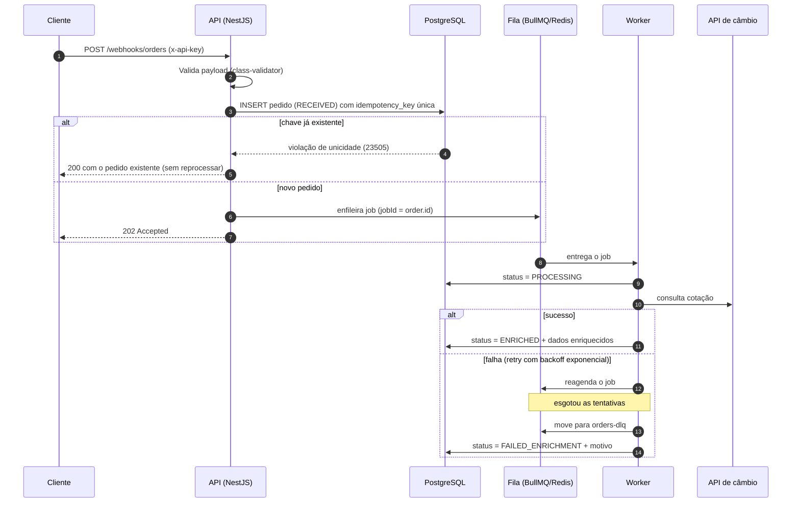
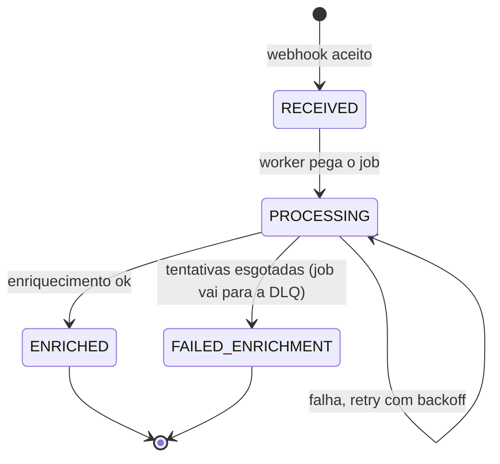

# Orquestrador de Pedidos

API em **NestJS** que recebe pedidos via webhook, valida, garante idempotência, persiste e processa de forma **assíncrona** por fila, enriquecendo os dados com um serviço externo de câmbio. Falhas passam por **retry com backoff exponencial** e, esgotadas as tentativas, o job vai para uma **DLQ** e o pedido fica como `FAILED_ENRICHMENT`.

## Sumário

- [Orquestrador de Pedidos](#orquestrador-de-pedidos)
  - [Sumário](#sumário)
  - [Arquitetura](#arquitetura)
  - [Stack](#stack)
  - [Como rodar](#como-rodar)
    - [Tudo com Docker (recomendado para avaliação)](#tudo-com-docker-recomendado-para-avaliação)
    - [Desenvolvimento local](#desenvolvimento-local)
    - [Comandos úteis](#comandos-úteis)
    - [Primeiros passos](#primeiros-passos)
    - [Solução de problemas](#solução-de-problemas)
  - [Variáveis de ambiente](#variáveis-de-ambiente)
  - [Endpoints](#endpoints)
    - [`POST /webhooks/orders`](#post-webhooksorders)
    - [`GET /health`](#get-health)
    - [`GET /orders`](#get-orders)
    - [`GET /orders/:id`](#get-ordersid)
    - [`GET /queue/metrics`](#get-queuemetrics)
  - [Documentação da API (Swagger)](#documentação-da-api-swagger)
  - [Configuração, logs e segurança](#configuração-logs-e-segurança)
  - [Enriquecimento, retry e DLQ](#enriquecimento-retry-e-dlq)
  - [Ciclo de vida do pedido](#ciclo-de-vida-do-pedido)
  - [Decisões técnicas](#decisões-técnicas)
  - [Testes](#testes)
    - [Como rodar os testes de integração](#como-rodar-os-testes-de-integração)
  - [Estrutura do projeto](#estrutura-do-projeto)
  - [Status](#status)
  - [Melhorias futuras](#melhorias-futuras)

## Arquitetura



Camadas, da borda para dentro:

| Camada | Responsabilidade |
|---|---|
| Controllers | HTTP, validação de entrada (DTOs), autenticação |
| Services | Regras de negócio, idempotência, transições de status |
| Processors | Consumo da fila, retry e DLQ |
| Clients | Integração com serviços externos, isolada atrás de uma interface |
| Entities/Migrations | Persistência e versionamento do schema |

## Stack

- Node.js 22, TypeScript, NestJS
- PostgreSQL 16 + TypeORM (com migrations)
- Redis 7 + BullMQ (`@nestjs/bullmq`)
- class-validator / class-transformer (validação dos DTOs)
- Zod (validação das variáveis de ambiente)
- Pino via `nestjs-pino` (logs estruturados)
- Helmet
- Swagger (`@nestjs/swagger`)
- Serviço externo: [Frankfurter](https://frankfurter.dev) (câmbio, gratuito e sem chave)
- Docker / Docker Compose

## Como rodar

### Tudo com Docker (recomendado para avaliação)

```bash
docker compose up --build
```

Não é preciso configurar nada: todas as variáveis têm valor padrão. O compose sobe PostgreSQL, Redis e a API, e as migrations rodam automaticamente na inicialização. Acompanhe com `docker compose ps` (o `app` fica `healthy` em alguns segundos) ou `docker compose logs -f app`.

| O quê | Onde |
|---|---|
| API | `http://localhost:3333` |
| Swagger (documentação interativa) | `http://localhost:3333/docs` |
| API Key padrão | `change-me` (header `x-api-key`) |

Para mudar qualquer valor, copie `.env.example` para `.env` (o compose o lê automaticamente) ou passe a variável no comando. Se as portas `5432`/`6379` já estiverem em uso na sua máquina, use outras só no host (dentro da rede do compose nada muda):

```bash
DB_PORT=5433 REDIS_PORT=6380 docker compose up --build
```

### Desenvolvimento local

Sobe só a infraestrutura e roda a API na máquina:

```bash
cp .env.example .env
docker compose up -d postgres redis
npm install
npm run migration:run
npm run start:dev
```

Pré-requisito: Node.js 22+ e Docker.

### Comandos úteis

```bash
npm run test           # testes unitários (rápidos, sem I/O)
npm run test:e2e       # testes de integração (requer Postgres e Redis no ar, veja "Testes")
npm run test:all       # unitários + integração
npm run test:cov       # cobertura (unitários + integração)
npm run lint           # ESLint (src e test)
npm run typecheck:test # checagem de tipos dos testes
npm run migration:generate -- src/database/migrations/NomeDaMigration
npm run migration:run
npm run migration:revert
npm run migration:show
docker compose ps      # estado dos serviços (app deve ficar healthy)
docker compose logs -f app
docker compose down -v # derruba tudo e apaga os volumes
```

### Primeiros passos

Com a API no ar, envie um pedido e acompanhe o processamento:

```bash
# 1. Envia um pedido (202 Accepted)
curl -X POST http://localhost:3333/webhooks/orders \
  -H "Content-Type: application/json" -H "x-api-key: change-me" \
  -d '{
    "order_id": "ext-123",
    "customer": { "email": "user@example.com", "name": "Ana" },
    "items": [{ "sku": "ABC123", "qty": 2, "unit_price": 59.9 }],
    "currency": "USD",
    "idempotency_key": "3f6c1c1e-8a4b-4a52-9d3e-0f9d2b1a7c10"
  }'

# 2. Alguns segundos depois: status ENRICHED, com o total convertido para BRL
curl "http://localhost:3333/orders" -H "x-api-key: change-me"

# 3. Reenviar o mesmo comando do passo 1 devolve 200 com o mesmo pedido (idempotência)

# 4. Estado da fila e da DLQ
curl http://localhost:3333/queue/metrics -H "x-api-key: change-me"
```

O enriquecimento consulta a API pública da Frankfurter, então precisa de acesso à internet. Sem ela, o pedido passa por retries com backoff e termina em `FAILED_ENRICHMENT` (com o motivo em `failure_reason` e um job na `orders-dlq`), que é o comportamento esperado para esse cenário.

### Solução de problemas

| Sintoma | O que fazer |
|---|---|
| `port is already allocated` ao subir o compose | Use portas alternativas no host: `DB_PORT=5433 REDIS_PORT=6380 docker compose up --build` |
| Quero recomeçar do zero | `docker compose down -v` (apaga também os volumes do banco e do Redis) |
| Ver o que a API está fazendo | `docker compose logs -f app` (logs em JSON, com `x-correlation-id` por requisição) |
| `401 Unauthorized` | Falta o header `x-api-key` (padrão `change-me`) ou ele não confere com `API_KEY` |
| Pedidos terminando em `FAILED_ENRICHMENT` | Veja `failure_reason` em `GET /orders/:id`. Se for "unreachable" ou "timed out", a API de câmbio está inacessível; ajuste `EXCHANGE_API_URL` se necessário |
| Os testes de integração abortam falando em "worker" | Há uma API rodando (`npm run start:dev`) consumindo a mesma fila: pare-a antes de rodar `npm run test:e2e` |

## Variáveis de ambiente

| Variável | Descrição | Padrão |
|---|---|---|
| `NODE_ENV` | `development` (logs legíveis), `production` (logs em JSON) ou `test` | `development` |
| `PORT` | Porta da API (no compose, é a porta publicada no host) | `3333` |
| `LOG_LEVEL` | `fatal`, `error`, `warn`, `info`, `debug`, `trace` ou `silent` | `info` (`debug` em desenvolvimento) |
| `API_KEY` | Chave exigida no header `x-api-key` | — |
| `DB_HOST` / `DB_PORT` / `DB_USER` / `DB_PASSWORD` / `DB_NAME` | Conexão com o PostgreSQL | `localhost` / `5432` / `postgres` / `postgres` / `orders` |
| `REDIS_HOST` / `REDIS_PORT` | Conexão com o Redis | `localhost` / `6379` |
| `EXCHANGE_API_URL` | URL base da API de câmbio | `https://api.frankfurter.dev/v1` |
| `TARGET_CURRENCY` | Moeda para a qual o total é convertido | `BRL` |
| `EXTERNAL_TIMEOUT_MS` | Timeout da chamada externa | `5000` |
| `ENRICHMENT_MAX_ATTEMPTS` | Tentativas antes de ir para a DLQ | `5` |
| `ENRICHMENT_BACKOFF_MS` | Delay base do backoff exponencial | `1000` |

As variáveis são validadas na inicialização: a aplicação não sobe com configuração inválida e a mensagem de erro lista todas as variáveis com problema.

No `docker compose`, o serviço `app` já recebe `DB_HOST=postgres`, `REDIS_HOST=redis` e as portas internas; as demais variáveis vêm do `.env` (se existir) ou dos valores padrão acima. Os valores padrão do compose coincidem com os do `.env.example`.

## Endpoints

Todos exigem o header `x-api-key: <API_KEY>`, exceto `GET /health` (público) e a documentação em `/docs`.

### `POST /webhooks/orders`

Recebe um pedido, valida, persiste como `RECEIVED` e enfileira.

```bash
curl -X POST http://localhost:3333/webhooks/orders \
  -H "Content-Type: application/json" \
  -H "x-api-key: change-me" \
  -d '{
    "order_id": "ext-123",
    "customer": { "email": "user@example.com", "name": "Ana" },
    "items": [{ "sku": "ABC123", "qty": 2, "unit_price": 59.9 }],
    "currency": "USD",
    "idempotency_key": "3f6c1c1e-8a4b-4a52-9d3e-0f9d2b1a7c10"
  }'
```

| Resposta | Quando |
|---|---|
| `202 Accepted` | Pedido novo, persistido e enfileirado |
| `200 OK` | `idempotency_key` já recebida: devolve o pedido existente, sem reprocessar |
| `400 Bad Request` | Payload inválido (a resposta lista os campos com erro) |
| `409 Conflict` | `order_id` já recebido com uma `idempotency_key` diferente |
| `503 Service Unavailable` | Pedido gravado, mas a fila não respondeu a tempo: reenvie a mesma `idempotency_key` |
| `401 Unauthorized` | `x-api-key` ausente ou inválida |

### `GET /health`

Público (sem API Key). Verifica a conectividade com o banco; devolve `200` ou `503`.

### `GET /orders`

Lista pedidos, do mais recente para o mais antigo, com paginação e filtro opcional por status.

| Parâmetro | Descrição | Padrão |
|---|---|---|
| `status` | `RECEIVED`, `PROCESSING`, `ENRICHED` ou `FAILED_ENRICHMENT` | sem filtro |
| `page` | Página (≥ 1) | `1` |
| `limit` | Itens por página (1 a 100) | `20` |

```bash
curl "http://localhost:3333/orders?status=ENRICHED&page=1&limit=20" -H "x-api-key: change-me"
```

```json
{
  "data": [
    {
      "id": "ab104f7b-f488-4431-ba5f-0cf697beaf38",
      "order_id": "ext-123",
      "status": "ENRICHED",
      "customer": { "email": "user@example.com", "name": "Ana" },
      "items": [{ "sku": "ABC123", "qty": 2, "unit_price": 59.9 }],
      "currency": "USD",
      "total": 119.8,
      "enrichment": {
        "target_currency": "BRL",
        "converted_total": 658.9,
        "exchange_rate": 5.5,
        "exchange_rate_date": "2026-10-20",
        "enriched_at": "2026-10-21T23:34:06.283Z"
      },
      "failure_reason": null,
      "attempts": 1,
      "created_at": "2026-10-21T23:34:06.262Z",
      "updated_at": "2026-10-21T23:34:06.284Z"
    }
  ],
  "meta": { "page": 1, "limit": 20, "total": 1, "total_pages": 1 }
}
```

Uma página além do fim devolve `200` com `data` vazio. Parâmetros inválidos (status desconhecido, `limit` fora de 1–100, `page` menor que 1 ou parâmetros que não existem) devolvem `400`.

### `GET /orders/:id`

Detalhes de um pedido (mesmo formato dos itens acima): dados de enriquecimento, número de tentativas e motivo da falha. Em um pedido que falhou, `enrichment` é `null` e `failure_reason` explica o motivo:

```json
{
  "id": "38fc77f0-e5b9-48c4-a5f1-a5f3ac86f1bc",
  "order_id": "ext-456",
  "status": "FAILED_ENRICHMENT",
  "enrichment": null,
  "failure_reason": "Exchange API responded with 500",
  "attempts": 5
}
```

| Resposta | Quando |
|---|---|
| `200 OK` | Pedido encontrado |
| `400 Bad Request` | `id` não é um UUID |
| `404 Not Found` | Pedido inexistente |

### `GET /queue/metrics`

Contagem de jobs da fila principal e da Dead Letter Queue, lida do Redis. Na DLQ, cada job `waiting` é um pedido que falhou de vez. Se o Redis estiver indisponível, responde `503` em até 3 s.

```json
{
  "prefix": "orders-orchestrator",
  "queue": {
    "name": "orders",
    "is_paused": false,
    "counts": { "waiting": 0, "active": 1, "delayed": 2, "completed": 42, "failed": 3 }
  },
  "dead_letter_queue": {
    "name": "orders-dlq",
    "is_paused": false,
    "counts": { "waiting": 3, "active": 0, "delayed": 0, "completed": 0, "failed": 0 }
  }
}
```

## Documentação da API (Swagger)

Com a API no ar:

| URL | Conteúdo |
|---|---|
| `http://localhost:3333/docs` | Swagger UI interativo |
| `http://localhost:3333/docs/json` | Especificação OpenAPI em JSON |

A página `/docs` é pública, mas as rotas da API (exceto `/health`) exigem a API Key. No Swagger UI, clique em **Authorize**, informe o valor de `API_KEY` e a chave passa a ser enviada no header `x-api-key` em todas as requisições (a autorização fica salva entre recarregamentos da página).

O plugin do `@nestjs/swagger` está habilitado no `nest-cli.json` (com `introspectComments`) e infere os schemas a partir dos tipos TypeScript e dos decorators do `class-validator`. Os DTOs de entrada ainda usam `@ApiProperty` para declarar exemplos e descrições de forma explícita (por exemplo, o formato da `idempotency_key`). Nos controllers, as respostas e os códigos de status são anotados com os decorators do Swagger.

## Configuração, logs e segurança

**Variáveis de ambiente.** São validadas com Zod na inicialização (`src/config/env.validation.ts`). Os valores numéricos são convertidos automaticamente e, se alguma variável obrigatória faltar ou for inválida, a aplicação não sobe e lista todos os problemas de uma vez:

```
Error: Invalid environment variables:
  - DB_USER: Invalid input: expected string, received undefined
```

**Configuração modular.** Cada preocupação tem o seu módulo em `src/config/` (logger, banco, filas, Swagger), e o `AppModule` só compõe esses módulos.

**Logs.** `nestjs-pino`: saída legível no desenvolvimento e JSON em produção. Cada requisição recebe um `x-correlation-id` (reaproveita o enviado pelo cliente ou gera um novo), devolvido no header da resposta e presente nos logs. O nível é controlado por `LOG_LEVEL`.

**Segurança.**
- Autenticação por API Key no header `x-api-key`.
- `helmet` aplicado a todas as rotas, com a CSP relaxada apenas em `/docs`, porque o Swagger UI usa scripts inline.
- `ValidationPipe` global com `whitelist` e `forbidNonWhitelisted`: campos fora do contrato são rejeitados com `400`.
- Segredos só em variáveis de ambiente; o `.env` não é versionado.

## Enriquecimento, retry e DLQ

O worker consulta a API de câmbio ([Frankfurter](https://frankfurter.dev)) e converte o total do pedido para `TARGET_CURRENCY`, gravando a moeda alvo, o total convertido, a cotação usada e a data dela. Se o pedido já está na moeda alvo, não há chamada externa (cotação 1).

**Classificação dos erros.** Repetir só faz sentido quando a falha pode se resolver sozinha:

| Situação | Classificação | O que acontece |
|---|---|---|
| Rede indisponível, timeout, HTTP `5xx`, HTTP `429`, corpo que não é JSON | Transitória | Retry com backoff exponencial |
| HTTP `4xx` (exceto `429`), moeda sem cotação na resposta | Permanente | Vai direto para a DLQ, sem gastar tentativas |
| Pedido inexistente | Permanente | Vai direto para a DLQ |

**Retry.** Até `ENRICHMENT_MAX_ATTEMPTS` tentativas, com atraso exponencial a partir de `ENRICHMENT_BACKOFF_MS` (ex.: 1 s, 2 s, 4 s, 8 s). Enquanto isso, o pedido permanece `PROCESSING` e `attempts` mostra quantas vezes o worker tentou.

**DLQ.** Na falha definitiva (erro permanente, tentativas esgotadas, ou job travado), o worker:
1. registra um job na fila `orders-dlq` com `orderId`, motivo, número de tentativas e data (o `jobId` é o id do pedido, então não duplica);
2. marca o pedido como `FAILED_ENRICHMENT` e grava o motivo em `failure_reason`.

Os jobs da DLQ ficam aguardando para inspeção ou reprocessamento manual (nenhum worker os consome). Se a DLQ estiver indisponível, o status do pedido continua sendo atualizado, porque é ele que o cliente consulta.

**Idempotência no processamento.** Um job reentregue para um pedido já `ENRICHED` ou `FAILED_ENRICHMENT` é ignorado, e as transições de status são atômicas no banco.

## Ciclo de vida do pedido



As transições são centralizadas no service e transições inválidas são rejeitadas. O processor também é idempotente: um job reentregue para um pedido já `ENRICHED` não refaz o trabalho.

## Decisões técnicas

**Idempotência garantida pelo banco.** `idempotency_key` tem constraint `UNIQUE`. A API tenta inserir e trata a violação de unicidade, em vez de fazer "consultar e depois inserir", que é vulnerável a race condition quando duas requisições idênticas chegam ao mesmo tempo.

**BullMQ + Redis.** Integração nativa com NestJS, retry e backoff configuráveis por job e métricas via `getJobCounts()`. Não existe DLQ nativa, então ela é implementada como uma segunda fila (`orders-dlq`) que recebe o job quando as tentativas se esgotam.

**Retry apenas para erros recuperáveis.** Timeout, erro de rede e 5xx são retentados com backoff exponencial. Erros permanentes (ex.: moeda inexistente, resposta 4xx) usam `UnrecoverableError` e vão direto para a DLQ, sem gastar tentativas.

**Valores monetários.** O total é calculado e armazenado de forma que evite erro de ponto flutuante (`numeric` no Postgres). Guardam-se também a cotação usada e a data dela, para o resultado ser auditável.

**Paginação por offset com ordem estável.** A listagem ordena por `created_at DESC` e usa o `id` como desempate, para que `created_at` repetido não faça pedidos aparecerem em duas páginas ou sumirem entre elas. O `limit` é limitado a 100 e a validação dos parâmetros rejeita valores inválidos com `400`.

**Unicidade em duas dimensões.** Além da `idempotency_key`, o `order_id` externo também é único. Reenvio com a mesma chave devolve o pedido existente (`200`); o mesmo `order_id` com outra chave é rejeitado com `409`. A constraint violada identifica qual dos casos ocorreu. Numa corrida entre requisições idênticas o Postgres pode citar a constraint de `order_id` em vez da de `idempotency_key`; por isso, antes de responder `409`, o service confere se a chave já pertence a um pedido (nesse caso é replay, `200`).

**Itens em `jsonb`.** Os itens são um snapshot do payload recebido e nunca são consultados individualmente, então ficam em uma coluna `jsonb` em vez de uma tabela separada. Se houver necessidade de consultas por SKU, vira uma tabela `order_items`.

**Enfileiramento idempotente e autorrecuperável.** O job usa `jobId = id do pedido`, então enfileirar duas vezes não cria dois jobs. O webhook enfileira sempre que o pedido está `RECEIVED` (novo **ou** replay): se o enqueue falhar, o cliente recebe `503`, reenvia a mesma `idempotency_key` e o pedido é enfileirado de novo. O worker, por sua vez, ignora pedidos que já avançaram, então uma reentrega nunca reprocessa.

**Timeout no enqueue.** Com o Redis fora do ar, o cliente do Redis acumula o comando e espera a reconexão. O produtor limita a espera a 3 s para o webhook falhar rápido (`503`) em vez de pendurar a requisição.

**Transições de status atômicas.** A máquina de estados (`order-status.transitions.ts`) define as transições válidas, e cada mudança é um `UPDATE ... WHERE status IN (origens válidas)`. Dois workers concorrentes, ou uma reentrega, não conseguem aplicar uma transição inválida nem sobrescrever um estado final.

**Redis compartilhado.** Todas as chaves usam o prefixo `orders-orchestrator`, o que permite usar um Redis que outros projetos também usam sem colisão de filas.

**Persistir antes de enfileirar (trade-off conhecido).** Se o insert der certo e o enqueue falhar, o pedido fica em `RECEIVED` sem job; o `503` + replay descrito acima recupera esse caso. Em produção, a solução definitiva seria o padrão **Transactional Outbox** (gravar o evento na mesma transação do pedido e um relay publicar na fila).

**Integração externa isolada.** O cliente de câmbio implementa a interface `ExchangeRateClient` (injetada por token), com timeout explícito e erros tipados. Trocar de provedor é trocar uma linha no `EnrichmentModule`, e os testes usam um mock, sem rede. A API usada é a v1 da Frankfurter, que está marcada como obsoleta (substituída pela v2) mas segue funcionando; migrar é uma mudança restrita a essa classe.

**Autenticação por API Key.** `ApiKeyGuard` global, comparação em tempo constante (`timingSafeEqual`).

**Migrations em vez de `synchronize`.** O schema é versionado e reproduzível.

## Testes

Tudo fica em `test/`, com a configuração do Jest em `test/jest.config.js` (dois projetos: `unit` e `e2e`).

- **Unitários** (`test/unit/`, espelham a estrutura de `src/`): idempotência e condições de corrida do `OrdersService`, máquina de estados (tabela completa de transições), DTOs (validação do webhook e dos filtros), classificação de erros do client Frankfurter (transitório x permanente), decisão de DLQ do processor, conversão em centavos, guard de API Key, validação de env e timeouts. Nenhum deles usa rede, banco ou Redis.
- **Integração** (`test/e2e/`): sobem a aplicação inteira (mesmo `configureApp` do `main.ts`) com **Postgres e Redis reais**. O provider `EXCHANGE_RATE_CLIENT` é substituído por um client fake controlável, então não há dependência de internet. Cobrem:
  - o fluxo da fila: `RECEIVED → PROCESSING → ENRICHED`, o estado intermediário `PROCESSING`, retry com backoff, `FAILED_ENRICHMENT` + job na `orders-dlq`, replay sem reprocessar;
  - idempotência sob concorrência (várias requisições simultâneas com a mesma chave);
  - `GET /orders` (paginação sem repetir nem perder pedidos, ordenação estável, filtros e validações), `GET /orders/:id` e `GET /queue/metrics`;
  - o client real da Frankfurter contra um servidor HTTP local (URL montada, 4xx, 5xx, timeout, corpo inválido).
- O backoff e o número de tentativas são pequenos nos testes (`ENRICHMENT_BACKOFF_MS=100`, `ENRICHMENT_MAX_ATTEMPTS=3`), e a espera usa polling com timeout, nunca sleep fixo.

### Como rodar os testes de integração

Os testes usam um banco próprio (`orders_test`, criado e migrado automaticamente) e nunca tocam o banco de desenvolvimento: o nome é obrigado a terminar em `_test`. Basta ter um Postgres e um Redis acessíveis.

```bash
# Postgres e Redis do compose em portas alternativas (não colidem com os seus)
DB_PORT=5433 REDIS_PORT=6380 docker compose up -d postgres redis

# Credenciais padrão do compose: postgres/postgres (as mesmas que os testes assumem)
TEST_DB_PORT=5433 TEST_REDIS_PORT=6380 npm run test:e2e
```

Variáveis disponíveis: `TEST_DB_HOST`, `TEST_DB_PORT`, `TEST_DB_USER`, `TEST_DB_PASSWORD`, `TEST_DB_NAME`, `TEST_REDIS_HOST`, `TEST_REDIS_PORT` (padrões: `localhost`, `5432`, `postgres`, `postgres`, `orders_test`, `localhost`, `6379`).

Cuidados com Redis compartilhado: as filas usam o prefixo fixo `orders-orchestrator`, e os testes apagam **somente** chaves com esse prefixo (nunca `FLUSHALL`). Se já existir um worker na fila (por exemplo, a API rodando com `npm run start:dev`), o setup aborta com uma mensagem pedindo para pará-la, porque ela consumiria os jobs dos testes.

## Estrutura do projeto

```
src/
├── main.ts
├── app.setup.ts                # configuração HTTP compartilhada com os testes (helmet, pipes, Swagger)
├── app.module.ts
├── config/
│   ├── env.validation.ts       # schema Zod das variáveis de ambiente
│   ├── logger.config.ts        # Pino + correlation id
│   ├── database.config.ts      # TypeORM (Postgres)
│   ├── queue.config.ts         # BullMQ (Redis), retry e backoff padrão
│   └── swagger.config.ts       # OpenAPI / Swagger UI
├── common/
│   ├── decorators/             # @Public()
│   ├── guards/                 # ApiKeyGuard (global)
│   └── utils/                  # withTimeout (falha rápido quando o Redis não responde)
├── health/                     # GET /health (público)
├── database/
│   ├── data-source.ts          # usado pelo CLI de migrations
│   └── migrations/
├── orders/                     # módulo de pedidos (produtor da fila)
│   ├── dto/                    # DTOs de entrada (webhook, filtros) e de resposta
│   ├── entities/               # entity Order, junto do módulo dono
│   ├── enums/                  # OrderStatus
│   ├── webhooks/               # controller de POST /webhooks/orders
│   ├── order-status.transitions.ts  # máquina de estados (transições válidas)
│   └── ...                     # controller, service, producer
├── enrichment/                 # módulo consumidor da fila
│   ├── clients/                # integração com a API de câmbio (interface + Frankfurter)
│   └── ...                     # processor, service, dead-letter, erros tipados
└── queue/                      # filas (orders, orders-dlq) e métricas
test/
├── jest.config.js              # configuração do Jest (projetos unit e e2e)
├── tsconfig.json               # tsconfig dos testes
├── unit/                       # testes unitários (espelham src/)
├── e2e/                        # testes de integração (Postgres e Redis reais)
└── support/                    # app de teste, client fake, helpers de polling e builders
```

Decisão: as entities ficam dentro do módulo dono (`orders/entities`), e `database/` guarda só a infraestrutura (data source e migrations). Assim cada módulo carrega o que lhe pertence e `database/` não vira um depósito de entities de domínio.

## Status

- [x] Scaffold, Docker, configuração validada (Zod), logs (Pino) e Swagger
- [x] Entity, migration, guard de API Key e `POST /webhooks/orders` com idempotência (testes unitários incluídos)
- [x] Enfileiramento no webhook, fila e processor com transições de status
- [x] Enriquecimento via API de câmbio (Frankfurter) com conversão do total
- [x] Retry com backoff exponencial, DLQ e `FAILED_ENRICHMENT` (erros transitórios x permanentes)
- [x] `GET /orders` (filtro e paginação), `GET /orders/:id`, `GET /queue/metrics`
- [x] Testes unitários e de integração (fluxo da fila, retry, DLQ, idempotência concorrente e endpoints de consulta)

## Melhorias futuras

- Transactional Outbox para eliminar a janela entre persistir e enfileirar.
- Validação de assinatura HMAC do payload do webhook.
- Índice composto `(status, created_at)` e paginação por cursor em `GET /orders`, caso o volume de pedidos cresça (offset fica mais lento nas páginas finais).
- Reconciliador para pedidos que ficarem presos em `PROCESSING` (por exemplo, se o banco cair justamente ao gravar `FAILED_ENRICHMENT`).
- Circuit breaker no cliente de câmbio e migração para a API v2 da Frankfurter.
- Comparar um hash do payload nos replays: hoje, reenviar a mesma `idempotency_key` com corpo diferente devolve o pedido original sem avisar.
- Endpoint para reprocessar jobs da DLQ.
- Rate limiting no webhook.
- Observabilidade: logs estruturados com correlation id, métricas Prometheus e tracing.
- Cache da cotação para reduzir chamadas ao serviço externo.
