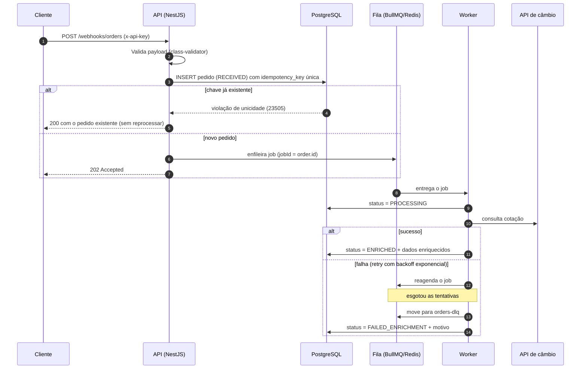
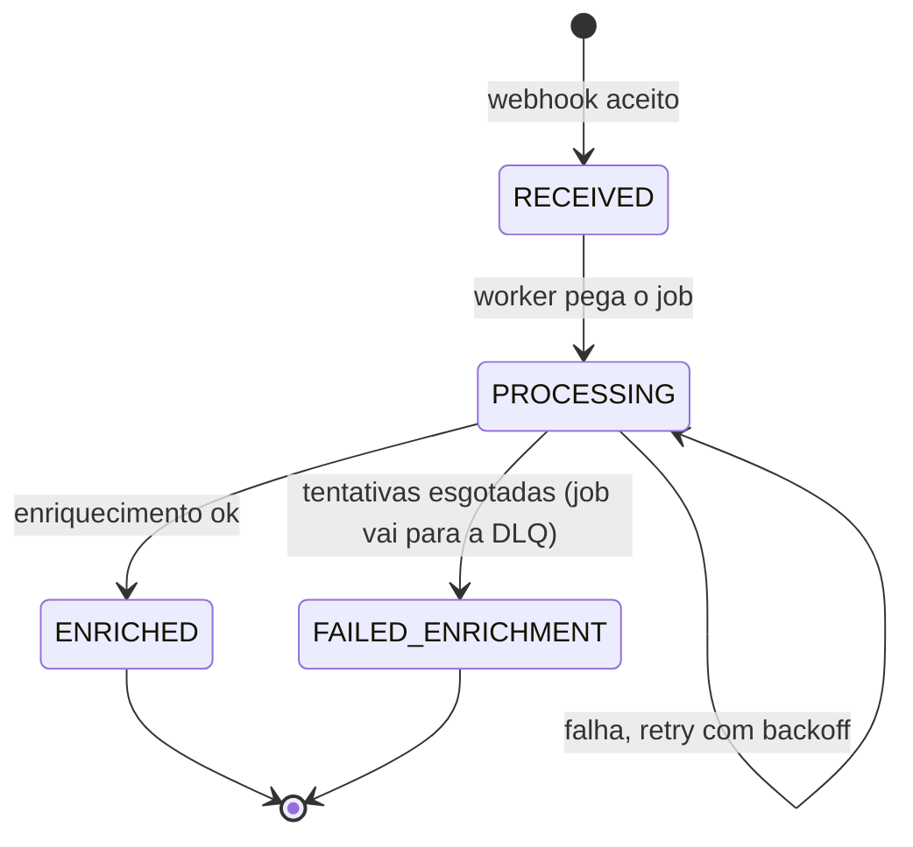

# Orquestrador de Pedidos

API em **NestJS** que recebe pedidos via webhook, valida, garante idempotência, persiste e processa de forma **assíncrona** por fila, enriquecendo os dados com um serviço externo de câmbio. Falhas passam por **retry com backoff exponencial** e, esgotadas as tentativas, o job vai para uma **DLQ** e o pedido fica como `FAILED_ENRICHMENT`.

## Sumário

- [Arquitetura](#arquitetura)
- [Stack](#stack)
- [Como rodar](#como-rodar)
- [Variáveis de ambiente](#variáveis-de-ambiente)
- [Endpoints](#endpoints)
- [Documentação da API (Swagger)](#documentação-da-api-swagger)
- [Configuração, logs e segurança](#configuração-logs-e-segurança)
- [Ciclo de vida do pedido](#ciclo-de-vida-do-pedido)
- [Decisões técnicas](#decisões-técnicas)
- [Testes](#testes)
- [Estrutura do projeto](#estrutura-do-projeto)
- [Status](#status)
- [Melhorias futuras](#melhorias-futuras)

## Arquitetura



Camadas, da borda para dentro:

| Camada | Responsabilidade |
|---|---|
| Controllers | HTTP, validação de entrada (DTOs), autenticação |
| Services | Regras de negócio, idempotência, transições de status |
| Processors | Consumo da fila, retry e DLQ |
| Clients | Integração com serviços externos, isolada atrás de uma interface |
| Entities/Migrations | Persistência e versionamento do schema |

## Stack

- Node.js 22, TypeScript, NestJS
- PostgreSQL 16 + TypeORM (com migrations)
- Redis 7 + BullMQ (`@nestjs/bullmq`)
- class-validator / class-transformer (validação dos DTOs)
- Zod (validação das variáveis de ambiente)
- Pino via `nestjs-pino` (logs estruturados)
- Helmet
- Swagger (`@nestjs/swagger`)
- Serviço externo: [Frankfurter](https://frankfurter.dev) (câmbio, gratuito e sem chave)
- Docker / Docker Compose

## Como rodar

### Tudo com Docker (recomendado para avaliação)

```bash
cp .env.example .env
docker compose up --build
```

A API sobe em `http://localhost:3333`, as migrations rodam automaticamente na inicialização e o Swagger fica em `http://localhost:3333/docs`.

### Desenvolvimento local

Sobe só a infraestrutura e roda a API na máquina:

```bash
cp .env.example .env
docker compose up -d postgres redis
npm install
npm run migration:run
npm run start:dev
```

Pré-requisito: Node.js 22+ e Docker.

### Comandos úteis

```bash
npm run test           # testes unitários
npm run test:e2e       # testes de integração (requer Postgres e Redis no ar)
npm run migration:generate -- src/database/migrations/NomeDaMigration
npm run migration:run
npm run migration:revert
npm run migration:show
docker compose down -v # derruba tudo e apaga os volumes
```

## Variáveis de ambiente

| Variável | Descrição | Padrão |
|---|---|---|
| `PORT` | Porta da API | `3333` |
| `API_KEY` | Chave exigida no header `x-api-key` | — |
| `DB_HOST` / `DB_PORT` / `DB_USER` / `DB_PASSWORD` / `DB_NAME` | Conexão com o PostgreSQL | `localhost` / `5432` / `postgres` / `postgres` / `orders` |
| `REDIS_HOST` / `REDIS_PORT` | Conexão com o Redis | `localhost` / `6379` |
| `EXCHANGE_API_URL` | URL base da API de câmbio | `https://api.frankfurter.dev/v1` |
| `TARGET_CURRENCY` | Moeda para a qual o total é convertido | `BRL` |
| `EXTERNAL_TIMEOUT_MS` | Timeout da chamada externa | `5000` |
| `ENRICHMENT_MAX_ATTEMPTS` | Tentativas antes de ir para a DLQ | `5` |
| `ENRICHMENT_BACKOFF_MS` | Delay base do backoff exponencial | `1000` |

As variáveis são validadas na inicialização: a aplicação não sobe com configuração inválida.

## Endpoints

Todos exigem o header `x-api-key: <API_KEY>`.

### `POST /webhooks/orders`

Recebe um pedido, valida, persiste como `RECEIVED` e enfileira.

```bash
curl -X POST http://localhost:3333/webhooks/orders \
  -H "Content-Type: application/json" \
  -H "x-api-key: change-me" \
  -d '{
    "order_id": "ext-123",
    "customer": { "email": "user@example.com", "name": "Ana" },
    "items": [{ "sku": "ABC123", "qty": 2, "unit_price": 59.9 }],
    "currency": "USD",
    "idempotency_key": "3f6c1c1e-8a4b-4a52-9d3e-0f9d2b1a7c10"
  }'
```

| Resposta | Quando |
|---|---|
| `202 Accepted` | Pedido novo, persistido e enfileirado |
| `200 OK` | `idempotency_key` já recebida: devolve o pedido existente, sem reprocessar |
| `400 Bad Request` | Payload inválido (a resposta lista os campos com erro) |
| `409 Conflict` | `order_id` já recebido com uma `idempotency_key` diferente |
| `503 Service Unavailable` | Pedido gravado, mas a fila não respondeu a tempo: reenvie a mesma `idempotency_key` |
| `401 Unauthorized` | `x-api-key` ausente ou inválida |

### `GET /health`

Público (sem API Key). Verifica a conectividade com o banco; devolve `200` ou `503`.

### `GET /orders`

Lista pedidos com paginação e filtro opcional por status.

```bash
curl "http://localhost:3333/orders?status=ENRICHED&page=1&limit=20" -H "x-api-key: change-me"
```

### `GET /orders/:id`

Detalhes de um pedido, incluindo dados enriquecidos, tentativas e motivo da falha (quando houver).

### `GET /queue/metrics`

Contagem de jobs da fila principal e da DLQ.

```json
{
  "queue": "orders",
  "waiting": 0,
  "active": 1,
  "completed": 42,
  "failed": 0,
  "delayed": 2,
  "dlq": { "waiting": 1 }
}
```

## Documentação da API (Swagger)

Com a API no ar:

| URL | Conteúdo |
|---|---|
| `http://localhost:3333/docs` | Swagger UI interativo |
| `http://localhost:3333/docs/json` | Especificação OpenAPI em JSON |

Todas as rotas exigem a API Key. No Swagger UI, clique em **Authorize**, informe o valor de `API_KEY` e a chave passa a ser enviada no header `x-api-key` em todas as requisições (a autorização fica salva entre recarregamentos da página).

Os schemas dos DTOs são gerados automaticamente pelo plugin do `@nestjs/swagger` (configurado no `nest-cli.json`), a partir dos tipos TypeScript, dos decorators do `class-validator` e dos comentários de documentação, então não há `@ApiProperty` repetido em cada campo. Apenas respostas e códigos de status são anotados nos controllers.

## Configuração, logs e segurança

**Variáveis de ambiente.** São validadas com Zod na inicialização (`src/config/env.validation.ts`). Os valores numéricos são convertidos automaticamente e, se alguma variável obrigatória faltar ou for inválida, a aplicação não sobe e lista todos os problemas de uma vez:

```
Error: Invalid environment variables:
  - DB_USER: Invalid input: expected string, received undefined
```

**Configuração modular.** Cada preocupação tem o seu módulo em `src/config/` (logger, banco, filas, Swagger), e o `AppModule` só compõe esses módulos.

**Logs.** `nestjs-pino`: saída legível no desenvolvimento e JSON em produção. Cada requisição recebe um `x-correlation-id` (reaproveita o enviado pelo cliente ou gera um novo), devolvido no header da resposta e presente nos logs. O nível é controlado por `LOG_LEVEL`.

**Segurança.**
- Autenticação por API Key no header `x-api-key`.
- `helmet` aplicado a todas as rotas, com a CSP relaxada apenas em `/docs`, porque o Swagger UI usa scripts inline.
- `ValidationPipe` global com `whitelist` e `forbidNonWhitelisted`: campos fora do contrato são rejeitados com `400`.
- Segredos só em variáveis de ambiente; o `.env` não é versionado.

## Ciclo de vida do pedido



As transições são centralizadas no service e transições inválidas são rejeitadas. O processor também é idempotente: um job reentregue para um pedido já `ENRICHED` não refaz o trabalho.

## Decisões técnicas

**Idempotência garantida pelo banco.** `idempotency_key` tem constraint `UNIQUE`. A API tenta inserir e trata a violação de unicidade, em vez de fazer "consultar e depois inserir", que é vulnerável a race condition quando duas requisições idênticas chegam ao mesmo tempo.

**BullMQ + Redis.** Integração nativa com NestJS, retry e backoff configuráveis por job e métricas via `getJobCounts()`. Não existe DLQ nativa, então ela é implementada como uma segunda fila (`orders-dlq`) que recebe o job quando as tentativas se esgotam.

**Retry apenas para erros recuperáveis.** Timeout, erro de rede e 5xx são retentados com backoff exponencial. Erros permanentes (ex.: moeda inexistente, resposta 4xx) usam `UnrecoverableError` e vão direto para a DLQ, sem gastar tentativas.

**Valores monetários.** O total é calculado e armazenado de forma que evite erro de ponto flutuante (`numeric` no Postgres). Guardam-se também a cotação usada e a data dela, para o resultado ser auditável.

**Unicidade em duas dimensões.** Além da `idempotency_key`, o `order_id` externo também é único. Reenvio com a mesma chave devolve o pedido existente (`200`); o mesmo `order_id` com outra chave é rejeitado com `409`. A constraint violada identifica qual dos casos ocorreu.

**Itens em `jsonb`.** Os itens são um snapshot do payload recebido e nunca são consultados individualmente, então ficam em uma coluna `jsonb` em vez de uma tabela separada. Se houver necessidade de consultas por SKU, vira uma tabela `order_items`.

**Enfileiramento idempotente e autorrecuperável.** O job usa `jobId = id do pedido`, então enfileirar duas vezes não cria dois jobs. O webhook enfileira sempre que o pedido está `RECEIVED` (novo **ou** replay): se o enqueue falhar, o cliente recebe `503`, reenvia a mesma `idempotency_key` e o pedido é enfileirado de novo. O worker, por sua vez, ignora pedidos que já avançaram, então uma reentrega nunca reprocessa.

**Timeout no enqueue.** Com o Redis fora do ar, o cliente do Redis acumula o comando e espera a reconexão. O produtor limita a espera a 3 s para o webhook falhar rápido (`503`) em vez de pendurar a requisição.

**Transições de status atômicas.** A máquina de estados (`order-status.transitions.ts`) define as transições válidas, e cada mudança é um `UPDATE ... WHERE status IN (origens válidas)`. Dois workers concorrentes, ou uma reentrega, não conseguem aplicar uma transição inválida nem sobrescrever um estado final.

**Redis compartilhado.** Todas as chaves usam o prefixo `orders-orchestrator`, o que permite usar um Redis que outros projetos também usam sem colisão de filas.

**Persistir antes de enfileirar (trade-off conhecido).** Se o insert der certo e o enqueue falhar, o pedido fica em `RECEIVED` sem job; o `503` + replay descrito acima recupera esse caso. Em produção, a solução definitiva seria o padrão **Transactional Outbox** (gravar o evento na mesma transação do pedido e um relay publicar na fila).

**Integração externa isolada.** O cliente de câmbio fica atrás de uma interface, com timeout explícito, o que permite trocar de provedor e mockar nos testes sem rede.

**Autenticação por API Key.** `ApiKeyGuard` global, comparação em tempo constante (`timingSafeEqual`).

**Migrations em vez de `synchronize`.** O schema é versionado e reproduzível.

## Testes

- **Unitários:** idempotência, transições de status, processor com o client externo mockado.
- **Integração/E2E:** sobem a aplicação com Postgres e Redis reais, enviam o webhook e verificam `RECEIVED → PROCESSING → ENRICHED`. Um segundo cenário força falha no client externo e verifica os retries, o envio à DLQ e o status `FAILED_ENRICHMENT`.
- A API externa é sempre mockada, então os testes não dependem de internet. O delay do backoff é configurável por env para os testes não ficarem lentos.

## Estrutura do projeto

```
src/
├── main.ts
├── app.module.ts
├── config/
│   ├── env.validation.ts       # schema Zod das variáveis de ambiente
│   ├── logger.config.ts        # Pino + correlation id
│   ├── database.config.ts      # TypeORM (Postgres)
│   ├── queue.config.ts         # BullMQ (Redis), retry e backoff padrão
│   └── swagger.config.ts       # OpenAPI / Swagger UI
├── common/                     # guards, filters, interceptors
├── database/
│   ├── data-source.ts          # usado pelo CLI de migrations
│   └── migrations/
├── orders/                     # módulo de pedidos (produtor da fila)
│   ├── entities/               # entity Order, junto do módulo dono
│   ├── enums/                  # OrderStatus
│   ├── webhooks/               # POST /webhooks/orders + DTOs
│   └── ...                     # controller, service
├── enrichment/                 # módulo consumidor da fila
│   ├── clients/                # integração com a API de câmbio
│   └── ...                     # processor, service
└── queue/                      # filas (orders, orders-dlq) e métricas
test/                           # testes de integração
```

Decisão: as entities ficam dentro do módulo dono (`orders/entities`), e `database/` guarda só a infraestrutura (data source e migrations). Assim cada módulo carrega o que lhe pertence e `database/` não vira um depósito de entities de domínio.

## Status

- [x] Scaffold, Docker, configuração validada (Zod), logs (Pino) e Swagger
- [x] Entity, migration, guard de API Key e `POST /webhooks/orders` com idempotência (testes unitários incluídos)
- [x] Enfileiramento no webhook, fila e processor com transições de status
- [ ] Enriquecimento via API de câmbio
- [ ] Retry com backoff, DLQ e `FAILED_ENRICHMENT`
- [ ] `GET /orders`, `GET /orders/:id`, `GET /queue/metrics`
- [ ] Testes unitários e de integração

## Melhorias futuras

- Transactional Outbox para eliminar a janela entre persistir e enfileirar.
- Validação de assinatura HMAC do payload do webhook.
- Comparar um hash do payload nos replays: hoje, reenviar a mesma `idempotency_key` com corpo diferente devolve o pedido original sem avisar.
- Endpoint para reprocessar jobs da DLQ.
- Rate limiting no webhook.
- Observabilidade: logs estruturados com correlation id, métricas Prometheus e tracing.
- Cache da cotação para reduzir chamadas ao serviço externo.
